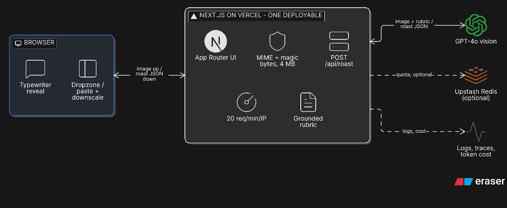
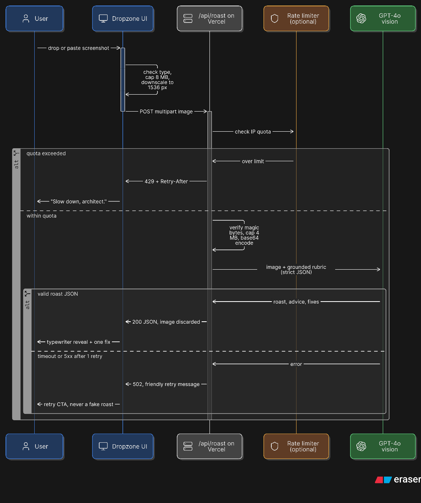
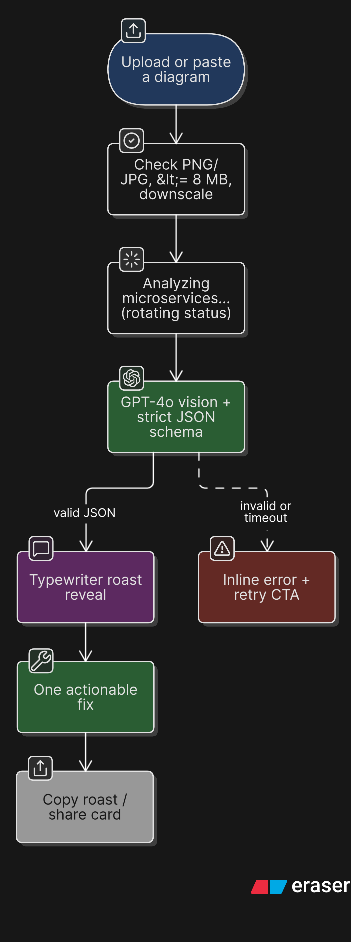

# ArchieRoast diagrams

Demo-ready diagrams rendered with [Eraser](https://eraser.io). PNGs are committed here because Eraser artifact URLs expire. The DSL and editor links live in [`renders.json`](./renders.json).

## 1. System architecture

[Open and edit in Eraser](https://app.eraser.io/new?requestId=gFqzaMX4YsW8JBa117MK&state=5NRu-CmTS3I_4GdKW2IgI)

Deliberate choices:

- **One deployable, not microservices.** Next.js App Router hosts both the UI and `/api/roast`.
- **Stateless.** No database, no blob storage; the uploaded image is processed in memory and discarded. Redis is optional and only stores rate-limit counters.
- **Input limits before the model.** The browser downscales to 1536 px; the server checks magic bytes and caps uploads at 4 MB, safely below serverless body limits.
- **Cost guard.** 20 req/min/IP via an optional Redis counter, plus a single vision call per roast.
- **Grounded output.** The prompt only allows critique of visible elements and returns strict JSON (`roast`, `advice`, `fixes`), so the UI never has to parse prose.
- **Operational visibility.** Latency, errors and token cost go to logs/traces, outside the request path.

## 2. Request sequence

[Open and edit in Eraser](https://app.eraser.io/new?requestId=au5IkQGp7Qg3unwtIifE&state=F-kDOoV1P0nI8bpmwAPvh)

Shows the happy path, quota rejection and model failure path. Failure returns a retryable error instead of inventing a roast.

## 3. User flow

[Open and edit in Eraser](https://app.eraser.io/new?requestId=XF11bM3Ohdd7lRnQ4x3s&state=YurdGco3vBVRi71OEr9g7)

The demo narrative: upload → rotating “analyzing” states → typed roast → one actionable fix → share.

## Other architecture examples

- [PulseBoard](./pulseboard/README.md) — product analytics with a Kafka ingest pipeline, ClickHouse and S3.
- [Relay](./relay/README.md) — reliable webhook delivery with a transactional outbox, retries and a DLQ.

## Regenerate

Paste the `code` value from the matching `architecture.json` or `renders.json` into the Eraser editor for that diagram type. The committed PNGs use the dark theme so they drop straight into a slide deck.
