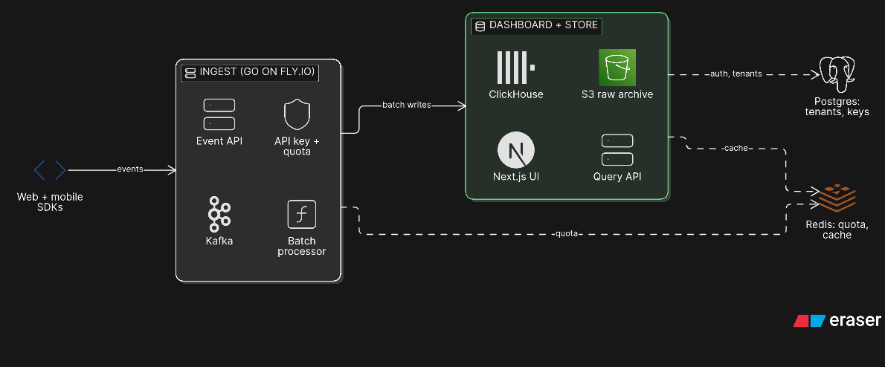

# PulseBoard — product analytics

A self-serve analytics product for indie SaaS: ingest events from web/mobile SDKs, store them cheaply, and serve fast dashboard queries.

[Open and edit in Eraser](https://app.eraser.io/new?requestId=iTlYU1IXs7XJe0XTdCjl&state=4RQ_iw7_vKneen10nnhJT)

## Why this shape

- **Ingest is isolated from reads.** Kafka absorbs traffic spikes; dashboard load cannot slow down event collection.
- **Two storage tiers.** ClickHouse serves aggregate queries; the raw event stream is archived in S3 for replay and backfills.
- **Postgres is the control plane.** It stores tenants, API keys and plan limits, not event data.
- **Redis is not a source of truth.** It holds quota counters and hot query cache; losing it degrades performance, not correctness.
- **One deployable for the UI.** The Next.js dashboard and query API live on Vercel; the ingest pipeline scales separately on Fly.io.
- **Batch writes.** The processor batches inserts into ClickHouse instead of one row per event, which keeps cost and write amplification sane.

## Request paths

1. SDK sends events with an API key.
2. Event API validates the key, checks the Redis quota and publishes to Kafka.
3. Batch processor reads Kafka, writes micro-batches to ClickHouse and archives raw events to S3.
4. Dashboard calls Query API, which reads ClickHouse and caches expensive results in Redis.

## Demo caveat

This is a reference architecture, not a claim that every box is implemented. For a hackathon build, keep the dashboard + Query API + ClickHouse path and stub the Kafka/S3 tier until ingest volume justifies it.
