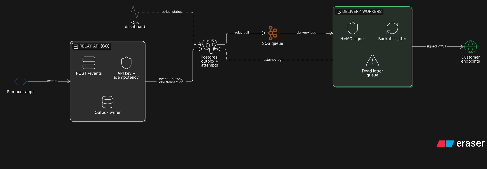

# Relay — reliable webhook delivery

A webhook delivery service for SaaS platforms: accepts events from producers and delivers them to customer endpoints with signing, retries and replay.

[Open and edit in Eraser](https://app.eraser.io/new?requestId=6PBDNMXnxAfIct9xjlYs&state=9UvfXh8iCc2-lqbAeY2LO)

## Why this shape

- **Transactional outbox.** The event and its outbox row are written in one Postgres transaction. No event is acknowledged unless it is durably queued for delivery.
- **Queue decouples acceptance from delivery.** A slow customer endpoint cannot back up the ingest API. SQS absorbs bursts and workers scale independently.
- **At-least-once delivery.** Consumers may see duplicates; every event carries a stable ID and idempotency key so receivers can dedupe.
- **Signed requests.** Workers sign the payload with HMAC and include a timestamp to limit replay windows.
- **Retries are bounded.** Exponential backoff with jitter handles transient failures; poison messages land in a DLQ instead of retrying forever.
- **Attempts are observable.** Every delivery attempt is logged in Postgres, and the ops dashboard exposes retries, failures and DLQ replay.

## Delivery path

1. Producer calls `POST /events` with an API key and idempotency key.
2. Relay API writes the event plus an outbox row in one transaction.
3. Outbox publisher polls Postgres and enqueues delivery jobs.
4. A worker signs the payload, calls the customer endpoint, and records the attempt.
5. Failures go back through the retry policy; exhausted jobs go to the DLQ.

## Demo caveat

The outbox publisher can be a small polling loop for a demo; it does not need Debezium or a separate CDC stack. Keep the outbox table and a unique idempotency constraint, and the reliability properties still hold.
